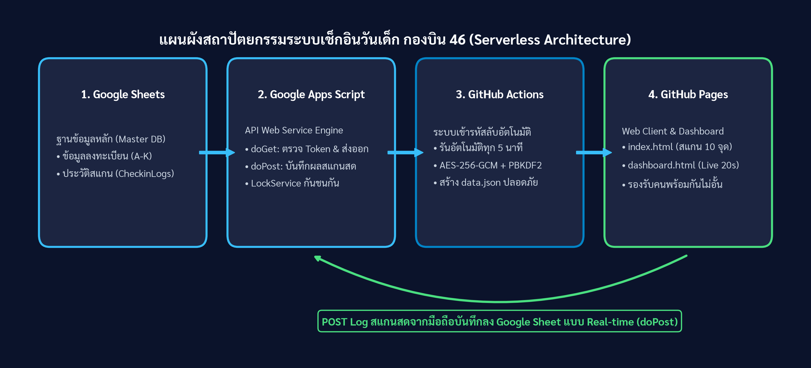

# คู่มือการใช้งานระบบเช็กอินและแดชบอร์ดบริหารจัดการ
## งานวันเด็กแห่งชาติ กองบิน 46 พิษณุโลก (PDPA Compliant)

---

### สารบัญ
1. [บทนำและสถาปัตยกรรมระบบ (System Architecture)](#1-บทนำและสถาปัตยกรรมระบบ-system-architecture)
2. [โครงสร้างฐานข้อมูลใน Google Sheets](#2-โครงสร้างฐานข้อมูลใน-google-sheets)
3. [คู่มือการใช้งานสำหรับเจ้าหน้าที่ประจำจุดสแกน (index.html)](#3-คู่มือการใช้งานสำหรับเจ้าหน้าที่ประจำจุดสแกน-indexhtml)
4. [คู่มือการใช้งานแดชบอร์ดมอนิเตอร์กลาง (dashboard.html)](#4-คู่มือการใช้งานแดชบอร์ดมอนิเตอร์กลาง-dashboardhtml)
5. [มาตรการความปลอดภัยและ PDPA Compliance](#5-มาตรการความปลอดภัยและ-pdpa-compliance)
6. [แนวทางการแก้ไขปัญหาเฉพาะหน้า (Troubleshooting)](#6-แนวทางการแก้ไขปัญหาเฉพาะหน้า-troubleshooting)

---

## 1. บทนำและสถาปัตยกรรมระบบ (System Architecture)

ระบบเช็กอินวันเด็กแห่งชาติ กองบิน 46 เป็นระบบเว็บแอปพลิเคชันแบบ **Serverless** ที่พัฒนาขึ้นเพื่อรองรับการตรวจเช็กอินผู้เข้าร่วมงานจำนวนมากได้อย่างรวดเร็ว แม่นยำ ปลอดภัยระดับทหาร และสอดคล้องตามมาตรฐานพระราชบัญญัติคุ้มครองข้อมูลส่วนบุคคล (PDPA)

```
[ Google Sheet ]  <=== (POST Log) ===  [ มือถือประจำจุดสแกน (index.html) ]
      | (Master Data)                                 ^
      v                                               |
[ Apps Script ]                                       | (ดึงข้อมูลถอดรหัสใน RAM)
      | (doGet)                                       |
      v                                               v
[ GitHub Actions ] ---(เข้ารหัส AES-256)---> [ data.json / GitHub Pages ]
                                                      |
                                                      v
                                        [ แดชบอร์ดกลาง (dashboard.html) ]
```


*ภาพที่ ๑: แผนผังสถาปัตยกรรมระบบเช็กอินแบบไร้เซิร์ฟเวอร์ (Serverless Architecture)*

### โครงสร้างการทำงานร่วมกัน 4 ส่วนหลัก:
1. **Google Sheets (Master Database):** ฐานข้อมูลแม่ จัดเก็บรายชื่อผู้ลงทะเบียนล่วงหน้า และแท็บบันทึกประวัติการสแกนสดจากภาคสนาม (`CheckinLogs`)
2. **Google Apps Script (API Web Service):** 
   - `doGet(e)`: ตรวจสอบความถูกต้องของ Token และส่งออกข้อมูลเป็น JSON
   - `doPost(e)`: รับข้อมูลการสแกนจากเครื่องสแกนเนอร์ บันทึกลงแท็บ `CheckinLogs` แบบ Real-time
3. **GitHub Actions (Automated Encryptor):** ดึงข้อมูลสดมาเข้ารหัสลับมาตรฐาน **AES-256-GCM** ร่วมกับ **PBKDF2 100,000 รอบ** ทุกๆ 5 นาที
4. **GitHub Pages (Web Client & Dashboard):** เผยแพร่หน้าเว็บสแกนเนอร์ (`index.html`) และแดชบอร์ดกลาง (`dashboard.html`) ผ่าน Cloud CDN เสถียรและเร็วสูง รองรับผู้ใช้งานพร้อมกันได้ไม่อั้น

---

## 2. โครงสร้างฐานข้อมูลใน Google Sheets

ไฟล์ Google Sheet หลักจะต้องประกอบด้วย 2 แท็บสำคัญ:

### 2.1 แท็บ `registrations` (ข้อมูลผู้ลงทะเบียน)
จัดเก็บข้อมูลคอลัมน์ A ถึง K ตามลำดับ:
- **A:** `TIME STAMP` (เวลาที่ลงทะเบียน)
- **B:** `ID` (รหัสคิวอาร์โค้ด เช่น W46XXXX)
- **C:** `ชื่อ`
- **D:** `นามสกุล`
- **E:** `เลขบัตรประชาชน`
- **F:** `เพศ`
- **G:** `เบอร์โทรศัพท์`
- **H:** `จำนวนคน`
- **I:** `ประเภทรถ`
- **J:** `ประเภทรถ อื่น ๆ`
- **K:** `ทะเบียนรถ`

> ⚠️ **หมายเหตุ:** หากตั้งค่า `HAS_HEADER_ROW = false;` ใน Apps Script แถวที่ 1 จะต้องเป็นข้อมูลผู้ลงทะเบียนคนแรกทันที (ห้ามมีข้อความหัวตาราง)

### 2.2 แท็บ `CheckinLogs` (ชีตบันทึกประวัติการสแกน)
- **แถวที่ 1 (หัวตาราง):** `UID` | `Station ID` | `Status` | `Timestamp`
- **แถวที่ 2 เป็นต้นไป:** ระบบจะทำการบันทึกข้อมูลการสแกนให้อัตโนมัติ

---

## 3. คู่มือการใช้งานสำหรับเจ้าหน้าที่ประจำจุดสแกน (index.html)

### ขั้นตอนการปฏิบัติงานหน้างาน:
1. เปิดลิงก์หน้าเว็บสแกนเนอร์ผ่านเบราว์เซอร์บนมือถือหรือแท็บเล็ต (แนะนำ Chrome หรือ Safari)
2. เลือกหมายเลขจุดสแกนประจำสถานี (เช่น `จุดสแกนที่ 1` ถึง `จุดสแกนที่ 10`)
3. กรอกรหัสผ่านประจำสถานี (Master Passphrase) แล้วกดปุ่ม **"ปลดล็อกระบบ"**
4. อนุญาตให้เบราว์เซอร์เข้าถึงกล้องถ่ายภาพ จากนั้นนำกล้องไปส่องที่ QR Code ของผู้เข้าร่วมงาน

### การแปลผลลัพธ์บนหน้าจอ:
* 🟢 **กล่องสีเขียว (พบข้อมูลในระบบ - สำเร็จ):** แสดงชื่อ-นามสกุล, เลขบัตรประชาชนและเบอร์โทร (Masked), ทะเบียนรถ และจำนวนคน ให้อนุญาตผ่านเข้างานได้
* 🟡 **กล่องสีเหลือง (สแกนซ้ำ - เช็กอินแล้ว):** ตรวจพบว่ารหัสนี้มีการเช็กอินไปแล้ว ให้ตรวจสอบหรือแนะนำให้ติดต่อเจ้าหน้าที่กองอำนวยการ
* 🔴 **กล่องสีแดง (ไม่พบข้อมูลในระบบ):** รหัส QR Code ไม่ตรงกับฐานข้อมูลผู้ลงทะเบียน

### ปุ่มฟังก์ชันควบคุมหน้างาน:
* **⚡ ปุ่มรีเฟรช:** บังคับดาวน์โหลดฐานข้อมูลชุดล่าสุดจากเซิร์ฟเวอร์ทันที
* **🗑️ ปุ่มล้างขยะ:** ล้างประวัติการสแกนบนหน้าจอและรีเซ็ตแคชในเครื่องมือถือ เพื่อแก้ปัญหาเครื่องจำรหัสเดิมและลดการใช้แรมของเครื่อง

---

## 4. คู่มือการใช้งานแดชบอร์ดมอนิเตอร์กลาง (dashboard.html)

หน้าจอแดชบอร์ดออกแบบมาเพื่อแสดงผลบนจอสมาร์ททีวี มอนิเตอร์ หรือแท็บเล็ตของผู้บังคับบัญชา:
1. กรอกรหัสผ่านหลัก (Master Passphrase) เพื่อถอดรหัสข้อมูลขึ้นสู่จอ
2. **ตัวเลขสถิติหลัก:** แสดงยอดรวมผู้ลงทะเบียนทั้งหมด และ ยอดผู้เช็กอินเข้างานจริง
3. **วงล้อกราฟโดนัท (Doughnut Chart):** แสดงสัดส่วนเปอร์เซ็นต์ผู้เข้างานแบบเคลื่อนไหว (Animated)
4. **ตารางสถิติประเภทรถ:** จัดอันดับจำนวนรถแต่ละประเภท (รถยนต์, รถจักรยานยนต์ ฯลฯ) เพื่อช่วยบริหารลานจอดรถ
5. **ตาราง 5 รายชื่อผู้เข้าร่วมล่าสุด:** แสดงสถานะ Check-In และระบุหมายเลขจุดสแกน โดยปิดบังข้อมูลตาม PDPA
6. **🎈 Popup การ์ตูนเด็กยิ้ม:** เด้งขึ้นมากลางจออัตโนมัติพร้อมชื่อผู้เช็กอิน เมื่อมียอดคนเข้างานเพิ่มขึ้น
7. **🟢 ระบบ Live อัตโนมัติ:** หน้าจอจะตรวจสอบและอัปเดตข้อมูลใหม่ทุกๆ **20 วินาที** โดยไม่ต้องกด F5 พร้อมมีปุ่ม **"⚡ รีเฟรช"** ที่มุมขวาบนสำหรับดึงข้อมูลสดได้ตามสั่ง

---

## 5. มาตรการความปลอดภัยและ PDPA Compliance


*ภาพที่ ๒: โครงสร้างความมั่นคงปลอดภัยและการปฏิบัติตามกฎหมาย PDPA*

* **การเข้ารหัสลับเกรดความมั่นคง (AES-256-GCM):** ข้อมูลรายชื่อทั้งหมดถูกเข้ารหัสลับสองชั้นด้วยกุญแจที่แปลงผ่าน PBKDF2 100,000 รอบ ทำให้แม้ไฟล์ข้อมูลจะถูกดักจับ ก็ไม่มีทางถอดรหัสได้หากไม่มี Passphrase
* **การปกปิดข้อมูลส่วนบุคคล (Data Masking):**
  - เลขบัตรประชาชน: ปิดบัง 6 หลักกลาง (เช่น `1234xxxxxx123`)
  - เบอร์โทรศัพท์: ปิดบัง 8 หลักแรก (เช่น `xxxxxxxx89`)
  - ชื่อบนหน้าแดชบอร์ดสาธารณะ: มีการย่อชื่อเพื่อคุ้มครองสิทธิส่วนบุคคล
* **การเก็บรักษาความลับ (Zero Secret Leak):** ไม่มี URL ลับ, Token ลับ หรือ Passphrase ปรากฏใน Source Code สาธารณะ ข้อมูลความลับทั้งหมดถูกจัดเก็บใน GitHub Repository Secrets

---

## 6. แนวทางการแก้ไขปัญหาเฉพาะหน้า (Troubleshooting)

| ปัญหาที่พบ | สาเหตุ | วิธีแก้ไข |
|---|---|---|
| **กล้องไม่เปิด / จอดำ** | ไม่ได้อนุญาตสิทธิ์กล้อง | ตรวจสอบการตั้งค่า Permissions ในเบราว์เซอร์ หรือเปลี่ยนไปใช้ Chrome / Safari |
| **สแกนแล้วขึ้น "สแกนซ้ำ" ทั้งที่เพิ่งเคลียร์ชีตไป** | มือถือจำประวัติไว้ในแคชเครื่อง (Local Storage) | กดปุ่มสีแดง **"🗑️ ล้างขยะ"** บนจอมือถือ แล้วกดรีเฟรชหน้าเว็บ 1 ครั้ง |
| **สแกนสำเร็จแต่ข้อมูลไม่เข้าชีต `CheckinLogs`** | โค้ด `doPost` ใน Apps Script ยังเป็น `getActiveSpreadsheet()` | เปลี่ยนเป็น `SpreadsheetApp.openById(SPREADSHEET_ID);` และกด Deploy New Version |
| **แก้ข้อมูลในชีตแล้ว หน้าเว็บยังไม่อัปเดต** | ยังไม่ถึงรอบ 5 นาทีของ GitHub Actions | ไปที่ GitHub > แท็บ Actions > คลิก "Sync and Encrypt Master Data" > กด "Run workflow" ข้อมูลจะซิงค์ใน 20 วินาที |
