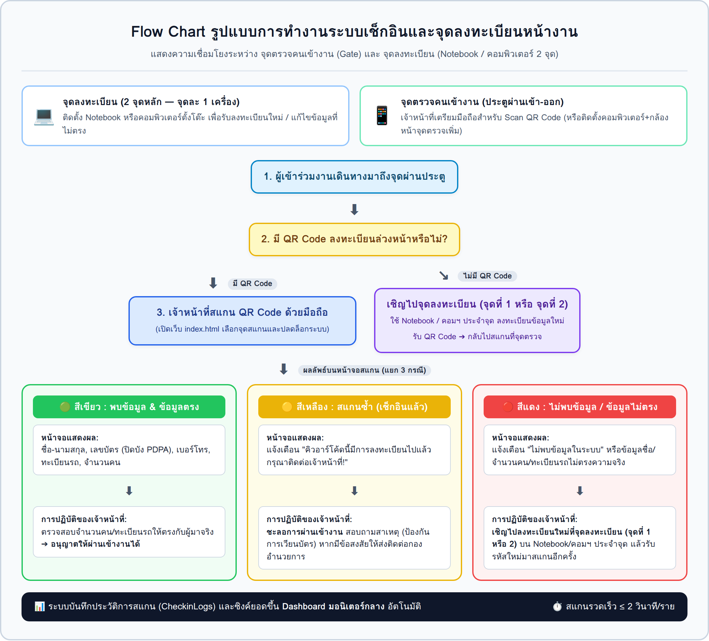
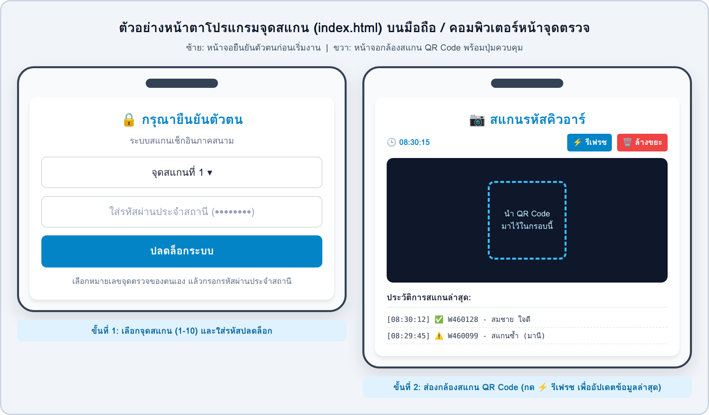
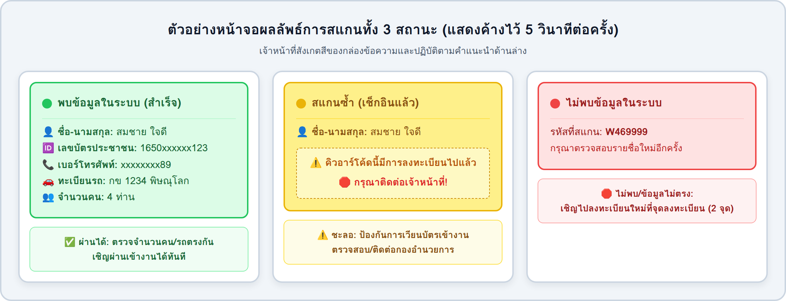
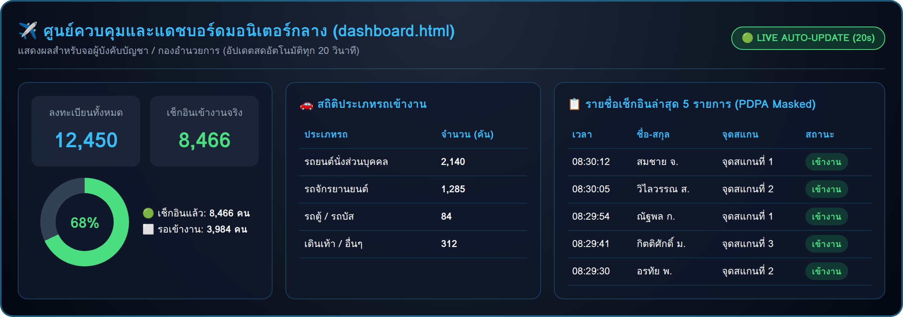
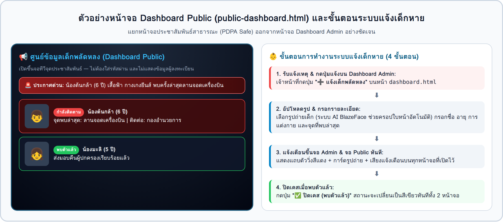
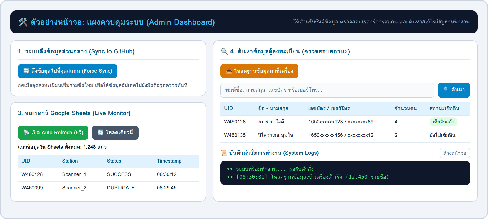
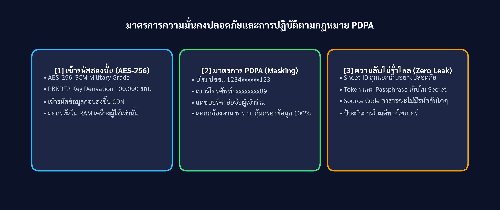

# คู่มือปฏิบัติงานระบบเช็กอินและจุดลงทะเบียนหน้างาน
## งานวันเด็กแห่งชาติ กองบิน 46 พิษณุโลก (Wing 46 Smart Check-in System)

---

### สารบัญ
1. [ภาพรวมของระบบและเป้าหมายการใช้งาน](#1-ภาพรวมของระบบและเป้าหมายการใช้งาน)
2. [การจัดเตรียมอุปกรณ์และจุดปฏิบัติงาน (Hardware & Station Setup)](#2-การจัดเตรียมอุปกรณ์และจุดปฏิบัติงาน-hardware--station-setup)
3. [แผนผังรูปแบบการทำงาน (Flow Chart)](#3-แผนผังรูปแบบการทำงาน-flow-chart)
4. [การใช้งานโปรแกรมจุดตรวจ (`index.html`) พร้อมตัวอย่างหน้าจอ](#4-การใช้งานโปรแกรมจุดตรวจ-indexhtml-พร้อมตัวอย่างหน้าจอ)
5. [ขั้นตอนการลงทะเบียนใหม่ที่จุดลงทะเบียน (2 จุดหลัก)](#5-ขั้นตอนการลงทะเบียนใหม่ที่จุดลงทะเบียน-2-จุดหลัก)
6. [Dashboard Admin (`dashboard.html`) และ Dashboard Public (`public-dashboard.html`)](#6-dashboard-admin-dashboardhtml-และ-dashboard-public-public-dashboardhtml)
7. [คู่มือการใช้งานระบบแจ้งเด็กหาย / เด็กพลัดหลง (AI + PDPA)](#7-คู่มือการใช้งานระบบแจ้งเด็กหาย--เด็กพลัดหลง-ai--pdpa)
8. [การทำงานของแอดมินและแผงควบคุมระบบ (Admin Dashboard)](#8-การทำงานของแอดมินและแผงควบคุมระบบ-admin-dashboard)
9. [การแก้ไขปัญหาเบื้องต้นหน้างาน (Troubleshooting)](#9-การแก้ไขปัญหาเบื้องต้นหน้างาน-troubleshooting)
10. [สถาปัตยกรรม ความปลอดภัย PDPA และขีดความสามารถ (SLA)](#10-สถาปัตยกรรม-ความปลอดภัย-pdpa-และขีดความสามารถ-sla)

---

## 1. ภาพรวมของระบบและเป้าหมายการใช้งาน

ระบบเช็กอินหน้างานถูกออกแบบมาเพื่อลดความแออัดและความล่าช้าบริเวณประตูทางเข้างาน โดยเปลี่ยนจากการค้นหารายชื่อบนกระดาษมาเป็นการ **สแกนคิวอาร์โค้ด (QR Code) ผ่านเว็บเบราว์เซอร์** ที่รวดเร็วไม่เกิน 2 วินาทีต่อราย พร้อมซิงค์ข้อมูลขึ้นหน้าจอแดชบอร์ดมอนิเตอร์กลางแบบเรียลไทม์ และคุ้มครองข้อมูลส่วนบุคคลตามกฎหมาย PDPA

> 💡 **หลักการสำคัญหน้างาน:** จุดตรวจประตูเน้นความเร็วในการสแกนผ่าน หากพบผู้ไม่มี QR Code หรือสแกนแล้ว **ไม่พบข้อมูล / ข้อมูลไม่ตรง** ให้เชิญไปดำเนินการลงทะเบียนใหม่ที่ **จุดลงทะเบียน** ทันที เพื่อไม่ให้แถวหน้าประตูติดขัด

---

## 2. การจัดเตรียมอุปกรณ์และจุดปฏิบัติงาน (Hardware & Station Setup)

| จุดปฏิบัติงาน | จำนวนจุด | อุปกรณ์ที่ต้องเตรียม | หน้าที่หลักหน้างาน |
|---|---|---|---|
| **จุดลงทะเบียน (Registration Point)** | **2 จุด** (จุดละ 1 เครื่อง) | Notebook หรือคอมพิวเตอร์ตั้งโต๊ะ พร้อมอินเทอร์เน็ต | รับลงทะเบียนใหม่สำหรับผู้ที่ไม่มี QR Code, ผู้ที่สแกนไม่พบข้อมูล หรือผู้ที่ข้อมูลไม่ตรงกับความจริง |
| **จุดตรวจคนเข้างาน (Gate / Checkpoint)** | ตามช่องทางเข้า (รองรับ `จุดสแกนที่ 1 - 10`) | มือถือสมาร์ทโฟนของเจ้าหน้าที่สำหรับ Scan (หรือติดตั้งคอมพิวเตอร์+กล้องหน้าจุดตรวจเพิ่ม) | เปิดเว็บ `index.html` สแกน QR Code ตรวจเช็กชื่อ จำนวนคน และทะเบียนรถก่อนปล่อยผ่าน |

* **หมายเหตุ:** กรณีใช้มือถือสแกน ควรเตรียม Power Bank ประจำจุด และเปิดผ่าน **Google Chrome (Android)** หรือ **Safari (iOS)**

---

## 3. แผนผังรูปแบบการทำงาน (Flow Chart)

---

## 4. การใช้งานโปรแกรมจุดตรวจ (`index.html`) พร้อมตัวอย่างหน้าจอ

### 4.1 การเข้าสู่ระบบและหน้าจอสแกน
1. เลือกหมายเลขจุดตรวจของตนเอง (เช่น **จุดสแกนที่ 1** ถึง **จุดสแกนที่ 10**)
2. กรอกรหัสผ่านประจำสถานี (Master Passphrase) แล้วกด **"ปลดล็อกระบบ"**
3. กดอนุญาตให้เบราว์เซอร์เข้าถึงกล้อง จากนั้นนำกล้องส่องที่ QR Code ของผู้เข้าร่วมงาน
4. **ปุ่มควบคุมด้านบน:** กด **⚡ รีเฟรช** เพื่อดึงรายชื่อล่าสุดทันที และกด **🗑️ ล้างขยะ** เพื่อล้างแคชประวัติในเครื่อง

### 4.2 การอ่านผลลัพธ์การสแกน 3 สถานะ (เขียว / เหลือง / แดง)

* 🟢 **สีเขียว — พบข้อมูลในระบบ (สำเร็จ):** แสดงชื่อ-นามสกุล, เลขบัตรประชาชน (ปิดบัง 6 หลักกลางตาม PDPA), เบอร์โทร, ทะเบียนรถ และจำนวนคน ➔ **อนุญาตให้ผ่านเข้างานได้**
* 🟡 **สีเหลือง — สแกนซ้ำ (เช็กอินแล้ว):** ระบบตรวจพบว่า QR Code นี้เคยเช็กอินไปแล้ว ➔ **ชะลอการปล่อยผ่าน** เพื่อป้องกันการเวียนบัตรและติดต่อกองอำนวยการ
* 🔴 **สีแดง — ไม่พบข้อมูลในระบบ หรือ ข้อมูลไม่ตรง:** ห้ามปล่อยผ่านโดยพลการ ➔ **เชิญไปลงทะเบียนใหม่ที่จุดลงทะเบียน (จุดที่ 1 หรือ 2)**

---

## 5. ขั้นตอนการลงทะเบียนใหม่ที่จุดลงทะเบียน (2 จุดหลัก)

1. สอบถามข้อมูลผู้เข้าร่วมงาน: ชื่อ-นามสกุล, เลขบัตรประชาชน, เบอร์โทรศัพท์, จำนวนผู้ติดตาม, ประเภทรถ และทะเบียนรถ
2. บันทึกข้อมูลลงระบบผ่าน Notebook / คอมพิวเตอร์ประจำจุดลงทะเบียน และออกรหัส / QR Code ใหม่
3. ซิงค์ข้อมูล: ระบบซิงค์อัตโนมัติทุก 5 นาที หรือให้แอดมินกด **Force Sync** บนแผงควบคุม และแจ้งจุดตรวจกด **⚡ รีเฟรช**
4. ผู้เข้าร่วมงานนำ QR Code ใหม่กลับไปสแกนผ่านประตูเข้างาน

---

## 6. Dashboard Admin (`dashboard.html`) และ Dashboard Public (`public-dashboard.html`)

| หัวข้อเปรียบเทียบ | Dashboard Admin (`dashboard.html`) | Dashboard Public (`public-dashboard.html`) |
|---|---|---|
| **ผู้ใช้งานหลัก** | ผู้บังคับบัญชา กองอำนวยการ และแอดมิน | ประชาชนทั่วไป และจอทีวีจุดประชาสัมพันธ์ |
| **การยืนยันตัวตน** | ต้องใส่ Master Passphrase เพื่อถอดรหัสข้อมูล | ไม่ต้องใส่รหัสผ่าน เปิดดูประกาศได้ทันที |
| **ข้อมูลที่แสดงผล** | ยอดลงทะเบียน, ยอดเช็กอิน, กราฟโดนัท, ประเภทรถ, รายชื่อล่าสุด 5 รายการ, Popup ต้อนรับ และประกาศเด็กพลัดหลง | แสดงเฉพาะแถบตัววิ่งและการ์ดประกาศเด็กพลัดหลง (ไม่เปิดเผยข้อมูลผู้ลงทะเบียน) |
| **สิทธิ์การจัดการเคส** | แจ้งเด็กพลัดหลงใหม่ (`➕`) และกดปิดเคส (`✅`) ได้ | ดูสถานะได้อย่างเดียว (Read-only) |

---

## 7. คู่มือการใช้งานระบบแจ้งเด็กหาย / เด็กพลัดหลง (AI + PDPA)

1. **แจ้งเหตุใหม่:** กดปุ่ม **➕ แจ้งเด็กพลัดหลง** บนหน้า Dashboard Admin (`dashboard.html`)
2. **อัปโหลดรูปและกรอกข้อมูล:** เลือกรูปถ่ายเด็ก (ระบบมี AI **BlazeFace** ตรวจจับใบหน้าและสร้างภาพแบบคาดปิด/เบลอใบหน้าตาม PDPA สำหรับจอ Public แยกจากภาพสำหรับแอดมิน) กรอกชื่อ อายุ การแต่งกาย จุดที่พบล่าสุด และเบอร์ติดต่อ
3. **กระจายประกาศอัตโนมัติ:** แถบตัววิ่งสีแดง การ์ดรูปถ่าย Flip Card และเสียงแจ้งเตือนจะแสดงขึ้นบนทั้งจอ Admin และจอ Public
4. **ปิดเคสเมื่อพบตัว:** กดปุ่ม **✅ ปิดเคส (พบตัวแล้ว)** สถานะจะเปลี่ยนเป็นสีเขียวทันทีทั้ง 2 หน้าจอ

---

## 8. การทำงานของแอดมินและแผงควบคุมระบบ (Admin Dashboard)

| ส่วนการทำงานบนหน้าจอ | ปุ่มและตัวเลือกสำคัญ | การใช้งานจริงเพื่อแก้ปัญหาหน้างาน |
|---|---|---|
| **1. ระบบดึงข้อมูลส่วนกลาง (Sync to GitHub)** | `🔄 ดึงข้อมูลไปที่จุดสแกน (Force Sync)` | กดเมื่อจุดลงทะเบียนเพิ่ม/แก้ไขรายชื่อใหม่ แล้วต้องการให้มือถือจุดตรวจสแกนเจอทันที |
| **3. จอเรดาร์ Google Sheets (Live Monitor)** | `📡 เปิด Auto-Refresh (5วิ)` / `🔄 โหลดเดี๋ยวนี้` | ดูยอดแถวทั้งหมดและประวัติสแกนสด (`UID \| Station \| Status \| Timestamp`) ทุก 5 วินาที |
| **4. ค้นหาข้อมูลผู้ลงทะเบียน (ตรวจสอบสถานะ)** | `📥 โหลดฐานข้อมูลมาที่เครื่อง` / `🔍 ค้นหา` | กดโหลดฐานข้อมูลก่อน แล้วพิมพ์ชื่อ นามสกุล เลขบัตร หรือเบอร์โทร เพื่อค้นหา `UID`, จำนวนคน และสถานะเช็กอิน |
| **บันทึกคำสั่งการทำงาน (System Logs)** | `ล้างหน้าจอ` | ดูสถานะการทำงานล่าสุด (`>> ระบบพร้อมทำงาน... รอรับคำสั่ง`) |

---

## 9. การแก้ไขปัญหาเบื้องต้นหน้างาน (Troubleshooting)

| ปัญหาที่พบหน้างาน | สาเหตุที่เป็นไปได้ | วิธีแก้ไขเบื้องต้น |
|---|---|---|
| **กล้องไม่เปิด / หน้าจอกล้องดำ** | ไม่ได้อนุญาตสิทธิ์กล้อง หรือเปิดผ่าน LINE/Facebook | เปลี่ยนไปเปิดด้วย Google Chrome หรือ Safari แล้วกดอนุญาต (Allow) สิทธิ์กล้อง |
| **สแกนแล้วขึ้น "ไม่พบข้อมูล" ทั้งที่เพิ่งลงทะเบียนใหม่** | มือถือจุดตรวจยังไม่ได้รับข้อมูลชุดล่าสุด | แอดมินกด **Force Sync** แล้วให้จุดตรวจกด **⚡ รีเฟรช** บนหน้าสแกน |
| **สแกนแล้วขึ้นสีเหลือง "สแกนซ้ำ"** | แคชในมือถือจำประวัติการสแกนเดิม | กดปุ่มสีแดง **🗑️ ล้างขยะ** บนหน้าสแกน แล้วกด **⚡ รีเฟรช** 1 ครั้ง |
| **อินเทอร์เน็ตมือถือหลุดชั่วคราว** | สัญญาณหน้างานหนาแน่น | สแกนต่อได้ทันที (ข้อมูลอยู่ใน RAM แล้ว ดาวน์ไทม์ = 0 นาที) เมื่อเน็ตกลับมาให้รีเฟรชเพื่อซิงค์ |
| **หน้าจอปลดล็อกขึ้นข้อผิดพลาด** | รหัสผ่าน (Passphrase) ผิดหรือมีเว้นวรรคเกิน | ตรวจสอบภาษาแป้นพิมพ์และกรอกรหัสผ่านประจำสถานีใหม่อีกครั้ง |

---

## 10. สถาปัตยกรรม ความปลอดภัย PDPA และขีดความสามารถ (SLA)

* **เข้ารหัสลับ AES-256-GCM (PBKDF2 100,000 รอบ):** ข้อมูลใน `data.json` ถอดรหัสเฉพาะใน RAM ของเครื่องผู้ใช้งาน
* **Data Masking & Dual PDPA:** ปิดบังเลขบัตร 6 หลักกลาง เบอร์โทร 8 หลักแรก ย่อชื่อบนแดชบอร์ด และแยกภาพเด็กพลัดหลงแบบเบลอ/คาดปิดใบหน้าบนจอสาธารณะ
* **Throughput:** 10 จุดสแกนรองรับได้ต่อเนื่อง **300–600 ราย/นาที** และ Google Sheets รองรับได้สูงสุด **500,000–900,000 รายชื่อ** (แนะนำ 20,000–50,000 รายการ)
