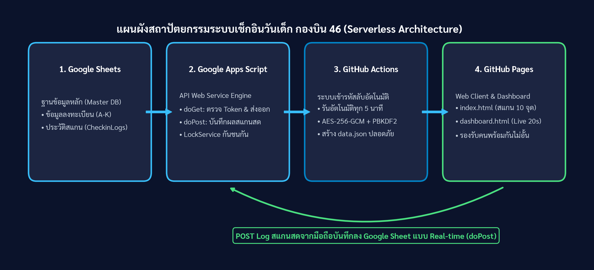
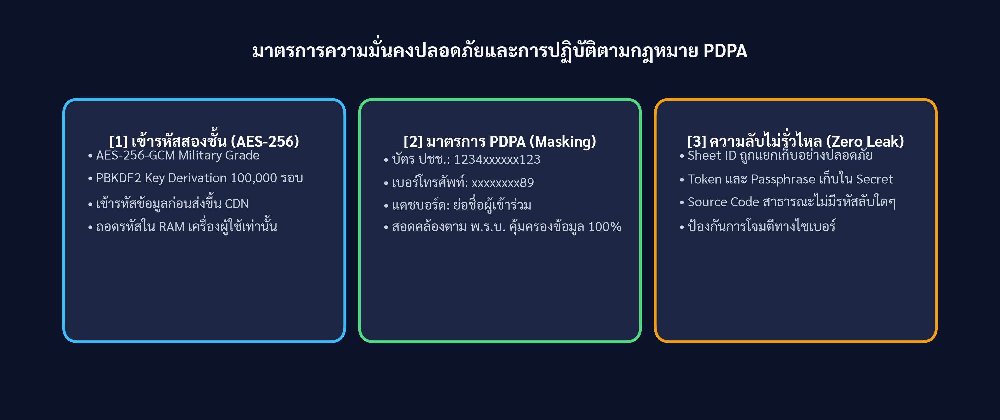

# ✈️ ระบบเช็กอินและแดชบอร์ดบริหารจัดการ งานวันเด็กแห่งชาติ
### กองบิน ๔๖ พิษณุโลก กองทัพอากาศ (Wing 46 Smart Check-in System)

<p align="center">
  
</p>

<p align="center">
  <b>ระบบเช็กอินภาคสนามความเร็วสูงแบบไร้เซิร์ฟเวอร์ (Serverless) ปลอดภัยระดับทหาร (AES-256) และสอดคล้องตาม PDPA ๑๐๐%</b>
</p>

---

## 📖 สารบัญ
1. [เกี่ยวกับระบบ](#-เกี่ยวกับระบบ)
2. [จุดเด่นสำคัญ](#-จุดเด่นสำคัญ)
3. [สถาปัตยกรรมและแผนผังการทำงาน](#-สถาปัตยกรรมและแผนผังการทำงาน)
4. [โครงสร้างไฟล์ในโปรเจกต์](#-โครงสร้างไฟล์ในโปรเจกต์)
5. [การใช้งานสำหรับเจ้าหน้าที่จุดสแกน (index.html)](#-การใช้งานสำหรับเจ้าหน้าที่จุดสแกน-indexhtml)
6. [การใช้งานแดชบอร์ดมอนิเตอร์กลาง (dashboard.html)](#-การใช้งานแดชบอร์ดมอนิเตอร์กลาง-dashboardhtml)
7. [การตั้งค่าระบบ (สำหรับผู้ดูแลระบบ)](#-การตั้งค่าระบบ-สำหรับผู้ดูแลระบบ)
8. [ความปลอดภัยและกฎหมาย PDPA](#-ความปลอดภัยและกฎหมาย-pdpa)
9. [เอกสารคู่มือและสไลด์นำเสนอ](#-เอกสารคู่มือและสไลด์นำเสนอ)

---

## 🌟 เกี่ยวกับระบบ

ระบบนี้ถูกพัฒนาขึ้นสำหรับใช้ใน **งานวันเด็กแห่งชาติ กองบิน ๔๖ พิษณุโลก** เพื่อแก้ปัญหาการจราจรติดขัดสะสมบริเวณประตูทางเข้าค่าย โดยเปลี่ยนจากการตรวจรายชื่อบนกระดาษแบบเดิม มาเป็นการ **สแกนคิวอาร์โค้ด (QR Code) ผ่านมือถือของเจ้าหน้าที่** ที่รวดเร็ว แม่นยำ ไม่เกิน ๒ วินาทีต่อคัน พร้อมทั้งมี **หน้าจอแดชบอร์ดแสดงผลสด (Live Dashboard)** ให้ผู้บังคับบัญชาเห็นยอดคนและปริมาณรถเข้างานแบบเรียลไทม์

---

## 🚀 จุดเด่นสำคัญ

* 📱 **ไม่ต้องติดตั้งแอปพลิเคชัน:** เจ้าหน้าที่ประจำจุดตรวจเปิดใช้งานผ่านเบราว์เซอร์บนมือถือได้ทันที (รองรับทั้ง iOS และ Android)
* ⚡ **สแกนรวดเร็วทันใจ:** ตรวจจับ QR Code ได้ทันที พร้อมระบบป้องกันการสแกนซ้ำซ้อน (Anti-bounce)
* 📊 **แดชบอร์ดสด (Live Auto-Update):** จอมอนิเตอร์กลางขยับปรับตัวเลขอัตโนมัติทุกๆ ๒๐ วินาที โดยไม่ต้องมีคนคอยกด F5
* 🔒 **ปลอดภัยระดับทหาร (AES-256-GCM):** ข้อมูลรายชื่อถูกเข้ารหัสลับอย่างหนาแน่น ถอดรหัสเฉพาะในเครื่องผู้ใช้งานเท่านั้น
* 🛡️ **ถูกต้องตามกฎหมาย PDPA ๑๐๐%:** เลขบัตรประชาชนและเบอร์โทรศัพท์ถูกปิดบังบางส่วน (Data Masking) อัตโนมัติ
* 💸 **ประหยัดงบประมาณ ๑๐๐% (Zero Cost):** ทำงานบนระบบ Serverless ของ GitHub Pages และ Google Workspace ไม่มีค่าเช่าเซิร์ฟเวอร์รายเดือน

---

## 🏗️ สถาปัตยกรรมและแผนผังการทำงาน

ระบบทำงานร่วมกัน ๔ ส่วนอย่างราบรื่นและปลอดภัย:

<p align="center">
  
</p>

1. **Google Sheets (ฐานข้อมูลแม่):** เก็บรายชื่อผู้ลงทะเบียนล่วงหน้า และบันทึกประวัติเวลาสแกนจริง
2. **Google Apps Script (ตัวเชื่อมต่อ API):** ทำหน้าที่ส่งออกข้อมูล และรับผลการสแกนสดจากมือถือบันทึกลงชีตทันที
3. **GitHub Actions (ตัวเข้ารหัสลับอัตโนมัติ):** วิ่งไปดึงข้อมูลจากชีตมาเข้ารหัสลับ AES-256 ทุกๆ ๕ นาที เพื่อความปลอดภัยสูงสุด
4. **GitHub Pages (เว็บเผยแพร่ข้อมูล):** ให้บริการหน้าเว็บสแกนเนอร์และหน้าจอแดชบอร์ด กระจายสัญญาณเร็วทั่วถึง ไม่มีปัญหาเว็บล่ม

---

## 📁 โครงสร้างไฟล์ในโปรเจกต์

```text
├── index.html                   # เว็บแอปสแกนคิวอาร์โค้ดภาคสนาม (สำหรับเจ้าหน้าที่ประตู ๑-๑๐)
├── dashboard.html               # จอแดชบอร์ดมอนิเตอร์กลางสำหรับผู้บริหาร (Live อัตโนมัติ)
├── LOGO.png                     # ตราสัญลักษณ์กองบิน ๔๖ พิษณุโลก
├── scripts/
│   └── export-encrypt.js       # สคริปต์ Node.js ดึงข้อมูลและเข้ารหัสลับ AES-256
├── .github/workflows/
│   └── sync-data.yml           # คำสั่งรัน GitHub Actions อัตโนมัติทุก ๕ นาที
└── DOCs/                        # โฟลเดอร์รวมเอกสารและสื่อนำเสนอ
    ├── CDs_Checkin_System_Manual.docx       # เล่มคู่มือทางการ (ฟอนต์ TH SarabunPSK)
    ├── CDs_Checkin_System_Presentation.pptx # สไลด์นำเสนอผู้บริหาร (16:9 Widescreen)
    ├── USER_MANUAL.md                       # คู่มือฉบับออนไลน์
    ├── architecture_diagram.png             # ภาพแผนผังระบบ
    └── security_flow.png                    # ภาพโครงสร้างความปลอดภัย PDPA
```

---

## 📱 การใช้งานสำหรับเจ้าหน้าที่จุดสแกน (`index.html`)

<p align="center">
  <b>เปิดลิงก์ผ่าน Google Chrome หรือ Safari บนมือถือ</b>
</p>

### ๑. ขั้นตอนการเข้าใช้งาน
1. เลือกหมายเลขจุดตรวจของตนเอง (เช่น **จุดสแกนที่ ๑** ถึง **จุดสแกนที่ ๑๐**)
2. ใส่รหัสผ่านประจำสถานี (Master Passphrase) แล้วกดปุ่ม **"ปลดล็อกระบบ"**
3. กดยินยอมให้เข้าถึงกล้องถ่ายภาพ จากนั้นนำกล้องไปส่องที่ QR Code ของผู้เข้าร่วมงาน

### ๒. ความหมายของสีที่แจ้งเตือนบนหน้าจอ:
* 🟢 **สีเขียว (พบข้อมูลในระบบ - สำเร็จ):** แสดงชื่อ-นามสกุล, ทะเบียนรถ, จำนวนคน ให้อนุญาตผ่านเข้างานได้
* 🟡 **สีเหลือง (สแกนซ้ำ - เช็กอินแล้ว):** คิวอาร์โค้ดนี้เคยเช็กอินเข้างานไปแล้ว ป้องกันการเวียนบัตร ให้ติดต่อกองอำนวยการ
* 🔴 **สีแดง (ไม่พบข้อมูลในระบบ):** คิวอาร์โค้ดไม่ถูกต้องหรือไม่มีในฐานข้อมูล

### ๓. ปุ่มควบคุมบนหน้าจอ:
* ⚡ **ปุ่มรีเฟรช:** บังคับดาวน์โหลดข้อมูลล่าสุดจากระบบทันที
* 🗑️ **ปุ่มล้างขยะ:** ล้างหน่วยความจำและรีเซ็ตประวัติในเครื่องมือถือ (ใช้เมื่อต้องการล้างแคชเครื่องให้ทำงานเบาสบาย)

---

## 📊 การใช้งานแดชบอร์ดมอนิเตอร์กลาง (`dashboard.html`)

ออกแบบมาสำหรับฉายขึ้น **จอสมาร์ททีวี มอนิเตอร์ หรือแท็บเล็ตของผู้บังคับบัญชา**:

* 🔒 กรอกรหัสผ่านหลักเพียงครั้งเดียว ระบบจะจำรหัสไว้และแสดงผลได้ตลอดทั้งวัน
* 👥 แสดงยอดรวมผู้ลงทะเบียนทั้งหมด และยอดผู้เช็กอินเข้างานจริง
* 🍩 กราฟวงล้อโดนัท (Doughnut Chart) แสดงเปอร์เซ็นต์สัดส่วนแบบเคลื่อนไหว
* 🚗 ตารางจัดอันดับประเภทรถที่เข้างาน (รถยนต์, มอเตอร์ไซค์ ฯลฯ) ช่วยบริหารลานจอดรถ
* 📋 ตาราง ๕ รายชื่อล่าสุด พร้อมหมายเลขจุดสแกน และสถานะ Check-In
* 🎈 **Popup การ์ตูนเด็กยิ้ม:** เด้งขึ้นมากลางจออัตโนมัติพร้อมชื่อผู้เช็กอิน เมื่อมียอดคนเข้างานเพิ่มขึ้น
* 🟢 **ระบบ Live อัตโนมัติ:** ตรวจสอบและอัปเดตข้อมูลสดทุกๆ ๒๐ วินาที โดยไม่ต้องกด F5

---

## ⚙️ การตั้งค่าระบบ (สำหรับผู้ดูแลระบบ)

### ๑. โครงสร้าง Google Sheets
* **แท็บ `registrations`:** เก็บรายชื่อผู้ลงทะเบียน คอลัมน์ A ถึง K (`TIME STAMP`, `ID`, `ชื่อ`, `นามสกุล`, `เลขบัตรประชาชน`, `เพศ`, `เบอร์โทรศัพท์`, `จำนวนคน`, `ประเภทรถ`, `ประเภทรถ อื่น ๆ`, `ทะเบียนรถ`)
* **แท็บ `CheckinLogs`:** บันทึกประวัติสแกน แถวที่ ๑ เป็นหัวตาราง (`UID | Station ID | Status | Timestamp`)

### ๒. การตั้งค่า GitHub Repository Secrets
เข้าไปที่ GitHub Repo ➔ **Settings** ➔ **Secrets and variables** ➔ **Actions** โดยมี ๓ ตัวแปรลับ:
* `GAS_EXPORTER_URL`: ลิงก์ Web App ของ Google Apps Script
* `GAS_EXPORTER_TOKEN`: รหัสโทเค็นลับสำหรับดึงข้อมูล
* `MASTER_PASSPHRASE`: รหัสผ่านสำหรับเข้ารหัสและปลดล็อกข้อมูลหน้างาน

---

## 🛡️ ความปลอดภัยและกฎหมาย PDPA

<p align="center">
  
</p>

1. **เข้ารหัสลับ AES-256-GCM:** มาตรฐานความมั่นคงสูง กุญแจแปลงผ่าน PBKDF2 วนลูป ๑๐๐,๐๐๐ รอบ แม้ไฟล์จะหลุดไปก็เปิดอ่านไม่ได้
2. **การปิดบังข้อมูลส่วนบุคคล (Data Masking):**
   * เลขประจำตัวประชาชน ๑๓ หลัก ➔ ปิดบัง ๖ หลักกลาง (เช่น `1234xxxxxx123`)
   * เบอร์โทรศัพท์ ➔ ปิดบัง ๘ หลักแรก (เช่น `xxxxxxxx89`)
   * ชื่อบนหน้าแดชบอร์ด ➔ มีการย่อชื่อเพื่อคุ้มครองความเป็นส่วนตัว
3. **ความลับไม่รั่วไหล (Zero Leak):** ไม่มี Sheet ID หรือ Token ใดๆ ปรากฏใน Source Code สาธารณะ

---

## 📚 เอกสารคู่มือและสไลด์นำเสนอ

เอกสารฉบับสมบูรณ์จัดเก็บอยู่ในโฟลเดอร์ **`DOCs/`** สามารถคลิกดาวน์โหลดได้ทันที:

* 📄 **[ดาวน์โหลดเล่มคู่มือทางการ (.docx)](DOCs/CDs_Checkin_System_Manual.docx):** คู่มือฉบับเต็มฟอนต์ราชการ TH SarabunPSK (เปิดใช้งานได้ทั้งใน Microsoft Word และ Google Docs)
* 📊 **[ดาวน์โหลดสไลด์นำเสนอ (.pptx)](DOCs/CDs_Checkin_System_Presentation.pptx):** สไลด์บรรยายสรุปผู้บริหาร ๑๐ สไลด์ รูปแบบ Widescreen 16:9 สีกรมท่ากองทัพอากาศ
* 📝 **[เปิดอ่านคู่มือออนไลน์ (USER_MANUAL.md)](DOCs/USER_MANUAL.md):** คู่มือฉบับอ่านสะดวกรวดเร็วบน GitHub

---

<p align="center">
  <b>กองบิน ๔๖ พิษณุโลก กองทัพอากาศ</b><br>
  <i>มุ่งมั่นนำเทคโนโลยีดิจิทัลมาเพิ่มประสิทธิภาพการปฏิบัติภารกิจและการบริการประชาชน</i>
</p>
